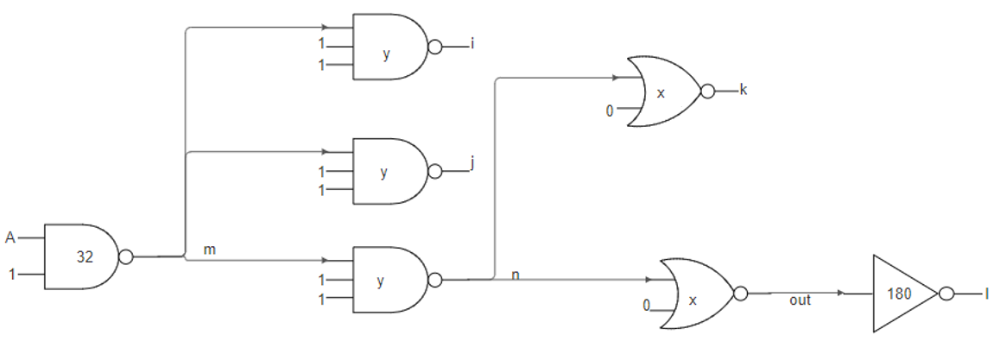
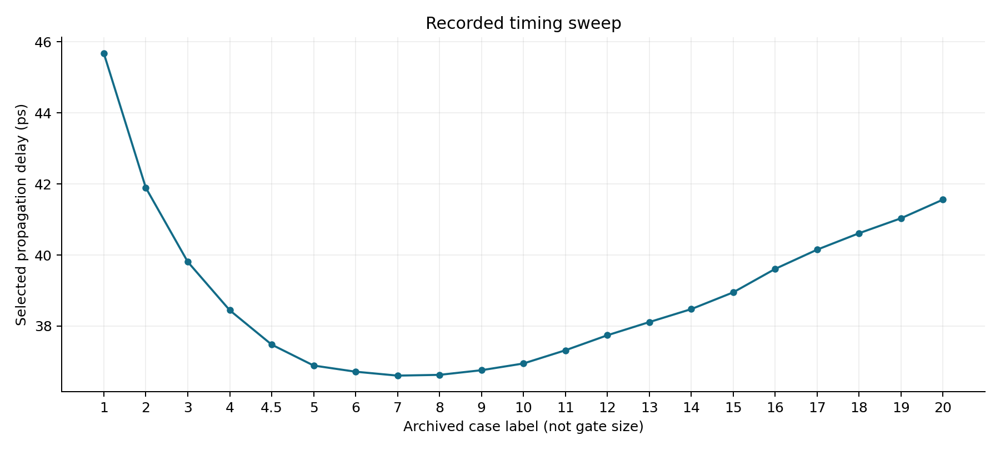
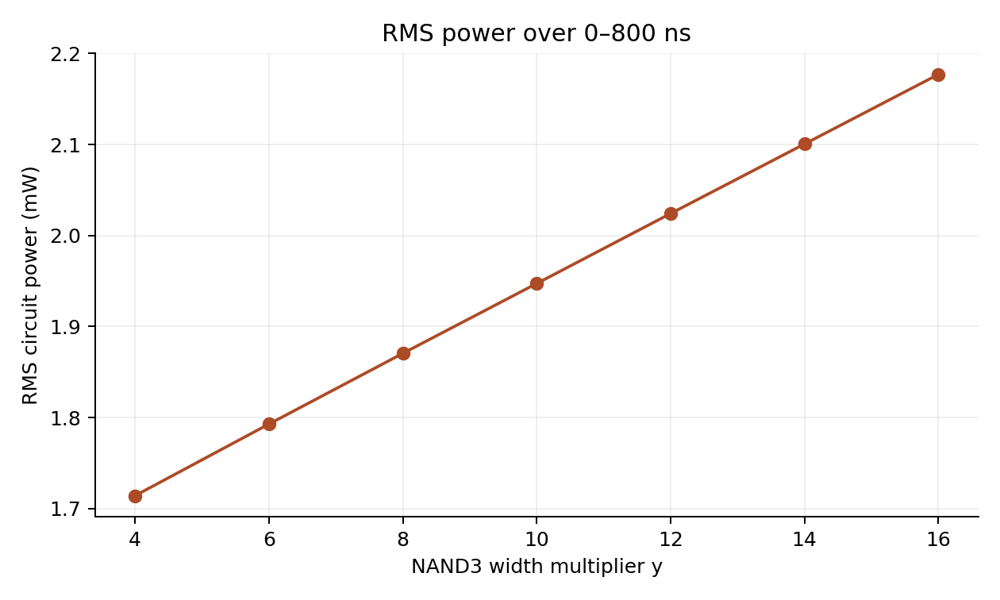

# Gate Sizing, Delay, and Power in a Branched CMOS Logic Network

HSPICE characterization of a 32 nm combinational network with parameterized inverter, NAND2, NAND3, and NOR2 cells. The experiment examines how intermediate-gate sizing affects output transitions, selected path delay, and circuit power under a fixed input stimulus.

The saved timing dataset contains **21 cases**. Its smallest selected propagation delay is **36.6058 ps in case 7**. A separately preserved seven-point NAND3 sizing sweep records RMS power increasing from **1.7141 mW at y = 4** to **2.1771 mW at y = 16**. These are archived simulation results; no new HSPICE run was performed during repository preparation.

## Circuit and engineering problem



*Figure 1. Circuit topology, branch loads, and node names. The characterized output is `out`, at the input of the final inverter; `l` is the inverter's output. Diagram labels 32 and 180 denote normalized input-capacitance targets, not channel lengths or literal width multipliers.*

The path of interest is `A → m → n → out`: NAND2, NAND3, then NOR2. Node m also drives two off-path NAND3 gates, and node n drives an additional NOR2 gate. The final inverter, sized at 60 times the base inverter, loads out.

The tied inputs make each path stage act as an inverter. Thus m is the complement of A, n follows A, out is the complement of A, and l follows A. Branch outputs i and j follow n; k follows out. The network contains seven gate instances and 32 MOSFETs.

The design question is whether increasing NAND3 width improves the selected path delay enough to justify increased loading and power. Only the NAND3 multiplier y is varied in the preserved power-sweep deck; x remains 12, the first NAND2 multiplier remains 8, and the load inverter remains 60.

## Sizing model and implemented widths

An ideal logical-effort estimate provides the design seed: path logical effort G = 100/27, branching factor B = 6, electrical effort H = 180/32, and total path effort F = 125. Equal stage effort is therefore 5. This gives normalized capacitance targets x = 60 and y = 40, translated into intended NOR2 and NAND3 multipliers of 12 and 8.

**The implemented cell widths do not match the resistance-normalized cells assumed by that estimate.** In every supplied gate subcircuit, each NMOS uses `size × 32 nm` and each PMOS uses `size × 64 nm`. Series NAND NMOS devices are not widened by the stack depth, and series NOR PMOS devices are not correspondingly widened. Accordingly, the ideal capacitance targets and logical-effort optimum are design assumptions, not calibrated properties of these netlists.

| Cell / group | Multiplier | Implemented NMOS width | Implemented PMOS width |
|---|---:|---:|---:|
| Input NAND2 | 8 | 256 nm | 512 nm |
| Three NAND3 gates, nominal | y = 8 | 256 nm | 512 nm |
| Two NOR2 gates | x = 12 | 384 nm | 768 nm |
| Load inverter | 60 | 1920 nm | 3840 nm |

Here, netlist x and y are width multipliers. They are not numerically interchangeable with the normalized capacitance labels in the diagram.

## Simulation conditions

| Parameter | Value |
|---|---|
| Technology model | `32nm_bulk.pm`, NMOS/PMOS BSIM4 model |
| Gate length / base NMOS width | 32 nm / 32 nm |
| Base PMOS width | 64 nm |
| Supply voltage | 1.8 V |
| Input A | PULSE, 200 ns period, nominal 100 ns high duration |
| Input rise/fall duration | 10 ps |
| Requested transient interval / duration | 1 ps / 800 ns |
| Archived measurement temperature | 25 °C |
| Power metric | RMS of HSPICE `power`, over 0–800 ns |
| Nominal deck outputs | A, m, n, out, l, k, j, i |

These results are specific to the supplied model and 1.8 V stimulus. They are not a process-qualified operating-voltage or reliability claim.

## Timing results

The archived file `results/reference/delay-cases.txt` contains output rise time, output fall time, and one selected propagation-delay measurement for each case. It contains 21 records, including an extra case labeled `4.5`.

| Archived case | Output rise time (ps) | Output fall time (ps) | Selected propagation delay (ps) |
|---|---:|---:|---:|
| 1 | 61.7423 | 28.1981 | 45.6738 |
| 4 | 53.0108 | **25.3087** | 38.4455 |
| 7 | 49.1417 | 26.4795 | **36.6058** |
| 10 | **48.6075** | 27.3868 | 36.9471 |
| 20 | 51.7799 | 31.9901 | 41.5603 |

The minima differ across metrics: case 7 minimizes the saved selected delay, case 10 minimizes output rise time, and case 4 minimizes output fall time. The smallest selected delay is about 19.85% below case 1. This is the best recorded case, not proof of a continuous or global optimum.



*Figure 2. Selected propagation delay versus archived case label. Case labels are identifiers, not gate-width multipliers; spacing is categorical.*

The full timing-sweep deck and its case-to-y mapping are absent. Therefore, case 7 must not be silently described as y = 7, and no verified optimum width is assigned here. The six `.alter` labels in the power deck are a separate numbering system and cannot be joined to the timing cases by label.

Output slew and path propagation delay are distinct measurements. The timing snippets describe 10–90% output rise and 90–10% output fall intervals. The saved `tp` entries contain one trigger/target pair near 100 ns, not the mean of two propagation directions. The preserved nominal deck has no `.measure` commands, and the complete `tp` measurement definition is not present in that deck.

## RMS power results

The power deck evaluates nominal y = 8 first, then `.alter` values 4, 6, 10, 12, 14, and 16. This run order was matched to the seven `s_power` results in the archived listing before sorting by y.

| NAND3 multiplier y | RMS power (mW) |
|---:|---:|
| 4 | 1.7141 |
| 6 | 1.7928 |
| 8 | 1.8705 |
| 10 | 1.9473 |
| 12 | 2.0242 |
| 14 | 2.1006 |
| 16 | 2.1771 |



*Figure 3. RMS circuit power from completed archived simulation runs, averaged quadratically over the 0–800 ns interval.*

RMS power increases by about 27.01% from y = 4 to y = 16 under this stimulus. RMS power is not time-average power:

$$P_{\mathrm{RMS}}=\sqrt{\frac{1}{T}\int_0^T p(t)^2\,dt},\qquad P_{\mathrm{avg}}=\frac{1}{T}\int_0^T p(t)\,dt.$$

Consumed energy is the integral of instantaneous power over a specified interval. Multiplying RMS power by propagation delay does not establish switching energy. A power-delay or energy-versus-size curve is consequently not derived here: the matching timing-size map and a suitable average-power or event-energy measurement are unavailable.

## Functional evidence and signal levels

The surviving nominal listing contains A, m, n, and out, but ends partway through the requested run. Representative settled samples support the expected inversion sequence while showing nonideal voltage levels:

| Time (ns) | A (V) | m (V) | n (V) | out (V) |
|---:|---:|---:|---:|---:|
| 50 | 1.8 | 0.11044 | 1.7776 | 0.02768 |
| 150 | 0 | 1.7925 | 0.16995 | 1.6866 |

These levels have the expected logic polarity at a 0.9 V threshold. They do not establish rail-to-rail operation or noise margins. The listing stops around 380.573 ns, lacks a completion footer, and does not preserve all eight requested node traces. It should not be treated as a complete 800 ns functional validation.

## Repository contents

| Path | Purpose |
|---|---|
| `netlists/nominal.sp` | Fixed x = 12, y = 8 waveform experiment |
| `netlists/power_sweep.sp` | Seven-run NAND3 RMS-power sweep |
| `models/README.md` | External model dependency |
| `results/delay-cases.csv` | All 21 saved timing records |
| `results/rms-power.csv` | Seven power results with verified run order and y values |
| `results/nominal-samples.csv` | Samples from the incomplete nominal listing |
| `results/reference/` | Original compact result exports and selected listing excerpts |
| `docs/figures/` | Circuit schematic and data-derived charts |
| `docs/technical-review.md` | Measurement and source-consistency limitations |
| `scripts/run.sh` | Local HSPICE batch runner |
| `runs/` | Generated outputs, excluded from Git |

## Running the available experiments

Place an authorized compatible copy of `32nm_bulk.pm` in `models/` and make HSPICE available on PATH. From the repository root:

```bash
bash scripts/run.sh
```

For a single run:

```bash
mkdir -p runs
cd netlists
hspice -i nominal.sp -o ../runs/nominal
```

Relative model includes require the `netlists/` working directory. The packaged sources change only the first-line title and model path. The archived power deck's `.print tran @device.power` expression is preserved, although HSPICE ignored it with an unrecognized-output warning. The separate RMS measurement did produce seven results. Review warnings in any rerun rather than assuming the print statement creates a usable power trace.

The nominal deck does not regenerate the saved timing table because it contains neither the full timing sweep nor its measurement directives. No electrical correction or fresh simulation has been substituted for the archived evidence. Before extending the optimization, define consistent cell normalization, restore the timing sweep with explicit size labels, and measure both propagation directions and energy with a stated accounting boundary.
